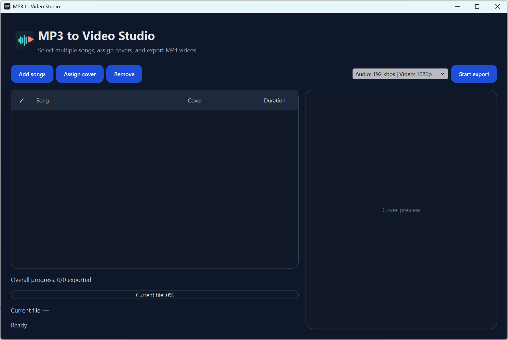

# MP3 to Video Studio

The application is designed to quickly create simple music videos from audio files. Each track uses a cover image and is exported together with the audio as an MP4 video.

Typical use cases:
- music uploads with cover art
- simple video output for songs or playlists
- batch export of multiple tracks



## Features
- multiple MP3 files in a list
- cover art per track
- modern dark UI
- automatic audio duration detection via `mutagen`
- export through `ffmpeg`
- progress display per file and overall
- cancel running exports

## Requirements
- Python (Tested with v3.11)
- `ffmpeg` installed and available in the system path
- the packages listed in `requirements.txt`

## Installation
It is recommended to use a virtual environment (`venv`).

### 1. Create and activate a virtual environment
```bash
python -m venv .venv
```

Activate it:
- Windows: `.\.venv\Scripts\Activate.ps1`
- Ubuntu / macOS: `source .venv/bin/activate`

### 2. Install dependencies
```bash
pip install -r requirements.txt
```

### 3. Start the application
```bash
python src/app.py
```

## Usage
1. Start the application.
2. Add MP3 files.
3. Assign a cover image to each track.
4. Choose an output folder.
5. Start the export.

